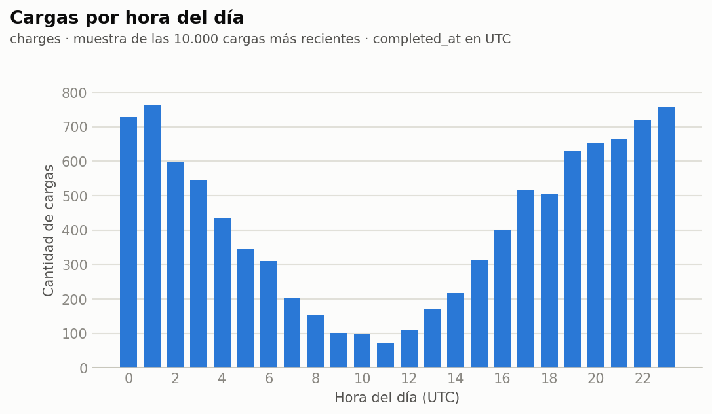
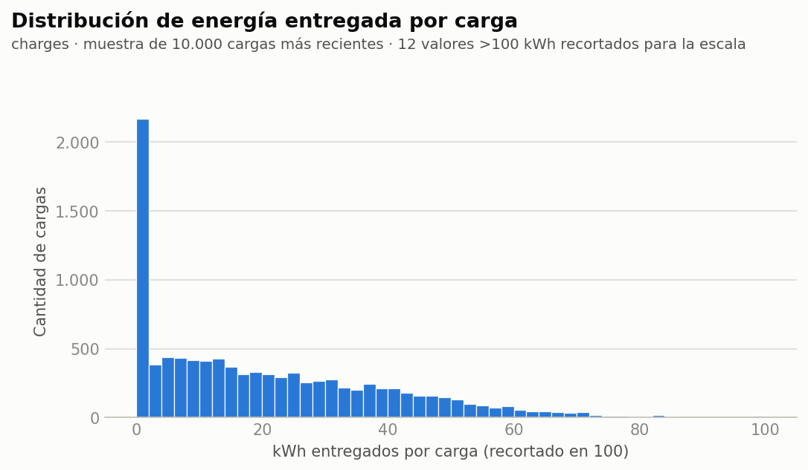
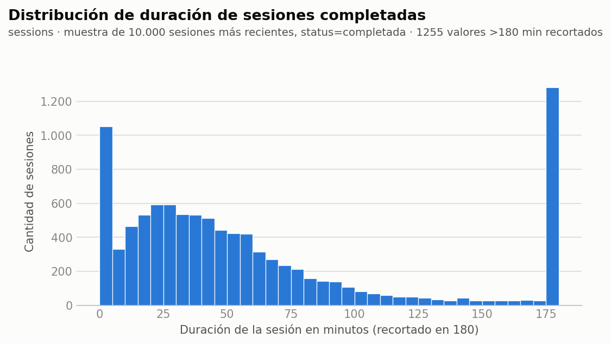
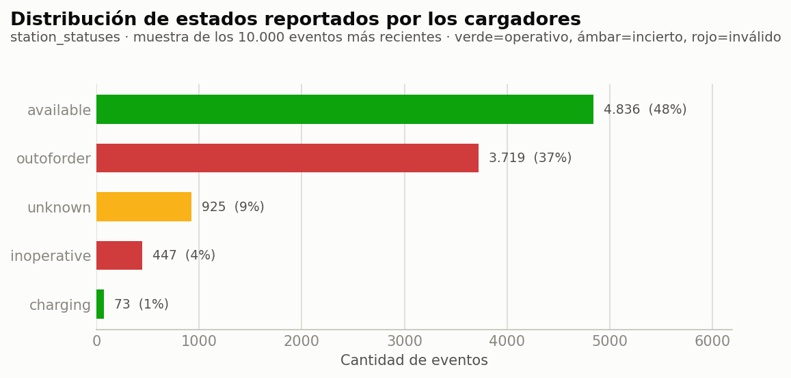
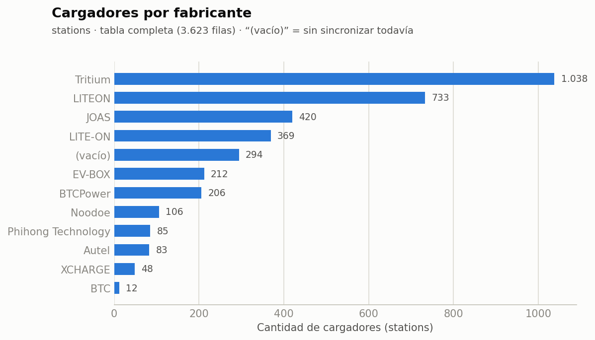
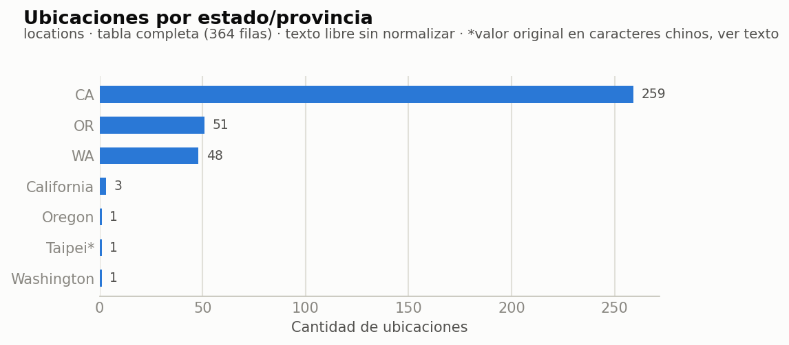

# Entrega 2 — Descripción del set de datos y diccionario de datos

*Todavía no está definida cuál de las 4 ideas de `propuesta_TFI.md` se va a desarrollar, así que este documento cubre la **totalidad de las tablas candidatas** (las 6 que aparecen en esa propuesta). Una vez elegida la idea, esto se puede recortar a las tablas que realmente se usen.*

---

## 1. Descripción general del set de datos

### 1.1 Origen y fuente
- **Sistema de origen:** base de datos de producción de EVCS (empresa de carga de vehículos eléctricos), motor PostgreSQL.
- **Acceso:** réplica de solo lectura.
- **Fecha de extracción de las cifras y muestras de este documento:** 2026-11-03.
- **Cómo se obtuvo:** consultas SQL directas sobre la réplica. Las consultas sobre tablas de alto volumen (`charges`, `sessions`, `station_statuses`) siempre usaron `LIMIT`, para no afectar el desempeño de la réplica — las cifras de volumen total son conteos exactos, pero las distribuciones/muestras son sobre una porción reciente, no sobre la tabla completa.

### 1.2 Volumen y granularidad

| Tabla | Unidad de observación (una fila es...) | Filas totales | Período cubierto |
|---|---|---|---|
| `charges` | una carga finalizada (evento de facturación) | 2.087.305 | 2020-10-13 a 2026-11-03 |
| `sessions` | una sesión de carga reportada vía OCPI (en curso o completada) | 1.787.827 | 2022-02-04 a 2026-11-03 |
| `station_statuses` | un evento de cambio de estado reportado por un cargador | ~44.987.439 | 2022-10-21 a 2026-11-03 |
| `stations` | un cargador físico instalado | 3.623 | altas desde 2022-08-24 |
| `locations` | una ubicación física que agrupa uno o más cargadores | 364 | altas desde 2021-09-11 |
| `plans` | un plan de suscripción ofrecido por EVCS | 30 | altas desde 2020-08-11 |

Las primeras tres son **transaccionales** (eventos, crecen todo el tiempo); las últimas tres son **maestras/catálogo** (crecen lento, describen entidades del negocio en vez de eventos).

### 1.3 Calidad de datos observada

- **Texto libre sin normalizar.** `stations.make` tiene variantes de un mismo fabricante escritas distinto (`LITEON` / `LITE-ON`, `XCHARGE` / `xcharge`) y ~140 filas con el campo vacío. `locations.state` mezcla `CA` con `California`, `WA` con `Washington`, y tiene un registro con el estado en caracteres chinos (`台北市`, Taipei) — señal de que hay al menos una ubicación fuera de EE. UU. que no sigue el formato esperado.
- **Nulos estructurales, no aleatorios.** `charges.user_id` y `sessions.user_id` están vacíos específicamente en cargas/sesiones de *roaming* (operador externo) sin usuario de EVCS identificado — no es un "MCAR", está correlacionado con el canal de pago (`payment_method`), más parecido a un patrón MAR. (Esto se debe a que hay cargas de usuarios que son reportadas a través de los cargadores pero, al usar un método de pago por fuera de la app, no podemos identificarlos).
- **`session_id` ausente junto con `cpo_session_id` presente** en una porción de `charges`: es la señal central de la Idea 3 (intentos de carga que nunca generaron una sesión OCPI local), no un error de carga de datos.
- **Columnas recién pobladas vacías.** Varias de las filas más nuevas de `stations` tienen `make`/`model` vacíos: son cargadores dados de alta que todavía no recibieron la sincronización de datos del fabricante — van a dejar de estar vacías solas con el tiempo. (Se puede solicitar a operaciones esta información en caso de ser necesario).
- **Outliers esperables.** `charges.kwh` tiene una masa importante en 0 (cargas que no llegaron a entregar energía) y una cola larga hacia valores altos (cargadores DC rápidos); `sessions` tiene sesiones con duración extremadamente larga (sesiones que nunca se cerraron correctamente del lado del cargador, nuestro sistema las marca como "terminadas" bajo ciertas condiciones para no dejar bloqueado al usuario en una carga activa).

### 1.4 Preprocesamiento sugerido antes de modelar

- Normalizar `stations.make` y `locations.state` a una categoría canónica antes de usarlos en clustering o análisis de correspondencias.
- Definir explícitamente un umbral para valores atípicos en `kwh` y `duration` (en vez de recortarlos sin criterio). Para esto, se debe aplicar el método de imputación de datos.
- Tratar los nulos de `user_id` como una categoría propia ("sesión sin usuario EVCS identificado") en vez de imputarlos, porque son estructurales y no aleatorios.
- **Definir cuántas filas conviene usar de las tablas transaccionales** (`charges`, `sessions`, `station_statuses`): la tabla completa no es necesariamente la mejor opción para entrenar — además del costo computacional de trabajar con decenas de millones de filas en `station_statuses`, el comportamiento más antiguo (2020-2022) puede no representar bien el comportamiento actual de usuarios y cargadores. Queda pendiente decidir una ventana (por ejemplo, los últimos 3 meses) en función de la idea elegida y de cuánto historial necesite cada técnica para generalizar bien.

---

## 2. Diccionario de datos

### 2.1 `charges`
| Campo | Tipo de dato | ¿Admite nulos? | Descripción | Ejemplo |
|---|---|---|---|---|
| `id` | entero grande (bigint) | No | Identificador único de la fila (clave primaria). | `2230295` |
| `user_id` | entero grande (bigint) | Sí | Usuario de EVCS que realizó la carga. Vacío cuando la carga la reporta un operador externo (roaming) sin que haya un usuario de EVCS identificado. | `131072` |
| `completed_at` | fecha y hora | Sí | Momento en que la carga quedó marcada como finalizada. | `2026-10-27 12:11:01.77` |
| `duration` | entero | Sí | Duración total de la carga, en segundos (desde que se conectó hasta que se desconectó). | `971` |
| `created_at` | fecha y hora | No | Fecha y hora en que se creó el registro. | `2026-10-27 12:11:03.550777` |
| `updated_at` | fecha y hora | No | Fecha y hora de la última modificación del registro. | `2026-10-27 12:11:03.614784` |
| `location_id` | entero | Sí | Ubicación física donde ocurrió la carga. | `472` |
| `subscription_id` | entero grande (bigint) | Sí | Suscripción/plan activo del usuario al momento de la carga, si tenía uno. | `41322` |
| `deleted_at` | fecha y hora | Sí | Fecha de borrado lógico (soft-delete); vacío = el registro sigue vigente. | *(sin valor no nulo en la muestra)* |
| `kwh` | decimal | Sí | Energía entregada durante la carga, en kWh. Un valor en 0 indica una carga que no llegó a entregar energía (ver Idea 3 de la propuesta). | `8.6567` |
| `price` | decimal | Sí | Monto cobrado al usuario por esta carga. | `6.96` |
| `charger_type` | texto corto | Sí | Tipo/potencia del cargador utilizado (ej. ac, dc50kw, dc150kw). | `dc50kw` |
| `connector` | texto corto | Sí | Tipo de conector físico utilizado (ej. CCS1, CHAdeMO, Type 1 (J-1772), Tesla). | `CHAdeMO` |
| `co2_saved` | decimal | Sí | Estimación de CO2 evitado por esta carga, calculada por el sistema (no medida directamente). | `9278.349` |
| `gas_saved` | decimal | Sí | Estimación de combustible fósil evitado por esta carga, calculada por el sistema. | `1.044` |
| `payment_method` | texto corto | Sí | Canal/medio de pago usado (ej. Card, Roaming - 002, Payter, Payter Cloud). | `Roaming - 002` |
| `session_id` | entero grande (bigint) | Sí | Sesión OCPI local asociada a esta carga. Vacío cuando la sesión OCPI nunca se creó del lado de EVCS (clave para la Idea 3). | `1778818` |
| `payment_gateway` | texto corto | Sí | Pasarela de pago que procesó el cobro (ej. payter). | `payter` |
| `during_trial_period` | booleano | Sí | Si la carga ocurrió durante un período de prueba del plan del usuario. | `f` |
| `station_id` | entero grande (bigint) | Sí | Cargador físico (station) en el que ocurrió la carga. | `2557` |
| `charging_duration` | entero | Sí | Duración de la carga reportada específicamente por el cargador/operador, en segundos (puede diferir de duration). | `971` |
| `price_per_kwh` | decimal | Sí | Tarifa por kWh aplicada a esta carga. | `0.6900` |
| `session_fee` | decimal | Sí | Cargo fijo por sesión, independiente del kWh consumido. | `0.99` |
| `free_kwh` | decimal | Sí | Cantidad de kWh de esta carga que no se cobraron (ej. por beneficio del plan). | `0.0000` |
| `notes` | texto largo | Sí | Texto libre interno con observaciones sobre la carga (ej. motivo de un ajuste de precio). Columna con datos sensibles, omitida en las muestras. | *(omitido)* |
| `user_car_id` | entero grande (bigint) | Sí | Vehículo del usuario asociado a la carga, si fue informado. | `105115` |
| `created_from` | entero | Sí | Origen/canal que generó la carga. Enum: 0=noodoe, 1=ads, 2=hertz, 3=hertz_retail, 4=lyft. | `4` |
| `trial_kwh` | decimal | Sí | DEPRECADO: Cantidad de kWh de esta carga cubiertos por el período de prueba. | *(sin valor no nulo en la muestra)* |
| `total_discount` | decimal | Sí | Descuento total aplicado al precio de esta carga. | `0.00` |
| `rating` | entero | Sí | Calificación que el usuario le dio a la carga (si la dejó). | `1` |
| `cpo_user_id` | texto corto | Sí | Identificador del usuario según el operador externo (CPO), cuando la carga viene de roaming. | *(sin valor no nulo en la muestra)* |
| `cpo_price` | decimal | Sí | Precio de la carga tal como lo informa el operador externo (puede diferir del price interno). | `35.08` |
| `cpo_session_id` | texto corto | Sí | Identificador de la sesión según el operador externo (CPO). Si está presente pero session_id está vacío, hubo un intento de carga real que nunca generó sesión OCPI local (Idea 3). | `s1zs-3347` |
| `cpo_encoded_id` | texto corto | Sí | Identificador interno/codificado que usa el operador externo para la transacción. | `auCRCV0eqGgOAUYU` |
| `cpo_last_4` | texto corto | Sí | Últimos 4 dígitos de la tarjeta informados por el operador externo. Columna sensible, omitida en las muestras. | *(omitido)* |
| `cpo_location_id` | texto corto | Sí | Identificador de la ubicación según el operador externo. | `/slMtHhXP66ZwGwPqTKFU` |
| `rfid` | texto corto | Sí | Identificador de la tarjeta/tag RFID usada para autenticar la carga. Columna sensible, omitida en las muestras. | *(omitido)* |

### 2.2 `sessions`
| Campo | Tipo de dato | ¿Admite nulos? | Descripción | Ejemplo |
|---|---|---|---|---|
| `id` | entero grande (bigint) | No | Identificador único de la fila (clave primaria). | `1778823` |
| `ocpi_id` | texto corto | Sí | Identificador de la sesión en el protocolo OCPI, usado para correlacionarla entre EVCS y el operador del cargador. | `6ae094f3e2d2bb45d98a7985` |
| `start_date_time` | fecha y hora | Sí | Momento en que comenzó la sesión de carga. | `2026-10-27 12:11:30.921` |
| `end_date_time` | fecha y hora | Sí | Momento en que terminó la sesión. Vacío = la sesión sigue abierta al momento de la consulta. | `2026-10-27 12:11:01.77` |
| `kwh` | decimal | Sí | Energía entregada durante la sesión, en kWh (se actualiza mientras la sesión está en curso). | `2.5360` |
| `total_cost_incl_vat` | decimal | Sí | Costo total de la sesión, impuestos incluidos. | `2.74` |
| `total_cost_excl_vat` | decimal | Sí | Costo total de la sesión, sin impuestos. | `2.74` |
| `cdr_token` | texto corto | Sí | Token de autorización del Charge Detail Record (OCPI). Columna sensible, omitida en las muestras. | *(omitido)* |
| `authorization_reference` | texto corto | Sí | Referencia de autorización de la sesión ante el operador externo. Columna sensible, omitida en las muestras. | *(omitido)* |
| `location_id` | entero grande (bigint) | Sí | Ubicación física donde ocurre la sesión. | `96` |
| `station_id` | entero grande (bigint) | Sí | Cargador físico (station) en el que ocurre la sesión. | `3086` |
| `connector_id` | entero grande (bigint) | Sí | Conector específico del cargador utilizado. | `3978` |
| `status` | entero | Sí | Estado de la sesión. Enum: 0=active, 1=completed, 2=not_valid, 3=pending, 4=reservation. | `0` |
| `created_at` | fecha y hora | No | Fecha y hora en que se creó el registro. | `2026-10-27 12:11:31.717183` |
| `updated_at` | fecha y hora | No | Fecha y hora de la última modificación del registro. | `2026-10-27 12:15:18.456467` |
| `user_id` | entero grande (bigint) | Sí | Usuario de EVCS dueño de la sesión. Vacío en sesiones de roaming sin usuario EVCS identificado. | `77541` |
| `intent` | texto corto | Sí | Identificador de intención de pago (ej. de Stripe) asociado a la sesión. | `pi_3UV9DuEWbleBd5sN1KHYMjXA` |
| `coupon_codes` | lista de texto corto | Sí (default: []) | Lista de códigos de cupón/descuento aplicados a la sesión. | `{}` |
| `pm_processor_id` | texto corto | Sí | Identificador del método de pago en el procesador (ej. Stripe payment method id). Columna sensible, omitida en las muestras. | *(omitido)* |
| `first_soc` | entero | Sí | Nivel de batería del vehículo (state of charge, %) al inicio de la sesión, si el cargador lo reporta. | `22` |
| `last_soc` | entero | Sí | Nivel de batería del vehículo (%) al final/último reporte de la sesión. | `26` |
| `first_reading_at` | fecha y hora | Sí | Momento de la primera lectura de medición recibida del cargador. | `2026-10-27 12:11:54.443` |
| `last_reading_at` | fecha y hora | Sí | Momento de la última lectura de medición recibida del cargador. | `2026-10-27 12:15:17.302` |
| `by_admin` | booleano | No (default: false) | Si la sesión fue iniciada/gestionada manualmente por un administrador en vez del flujo normal de usuario. | `f` |
| `code` | texto corto | Sí | Código corto de la sesión, usado por ejemplo en los links de resumen que se le envían al usuario. | `2d87df76` |
| `phone` | texto corto | Sí | Teléfono asociado a la sesión cuando se inició sin usuario logueado (ej. por SMS). Columna sensible, omitida en las muestras. | *(omitido)* |
| `connection_id` | entero grande (bigint) | Sí | Conexión (vínculo vehículo-cargador) asociada a la sesión. | `49328` |
| `cpo_id` | entero grande (bigint) | Sí | Operador de carga (CPO) que gestiona físicamente el cargador de esta sesión. | `1` |
| `price_per_kwh_discount` | entero | Sí | Descuento por kWh aplicado a la sesión, en porcentaje. | `0` |
| `widget_token` | texto corto | Sí | Token de sesión para el widget web embebido de carga. Columna sensible, omitida en las muestras. | *(omitido)* |
| `ocpi_update_count` | entero | Sí | Cantidad de actualizaciones OCPI recibidas para esta sesión (mide la frecuencia de reporte del cargador). | `12` |
| `promo_id` | entero grande (bigint) | Sí | Promoción aplicada a la sesión, si corresponde. | *(sin valor no nulo en la muestra)* |
| `emsp_id` | entero grande (bigint) | Sí | Operador de movilidad eléctrica (EMSP) a través del cual se autorizó la sesión, en escenarios de roaming. | `10` |
| `power` | decimal | Sí | Potencia instantánea reportada al inicio/en el último reading, en kW. | `48.454` |
| `max_power` | decimal | Sí | Potencia máxima alcanzada durante la sesión, en kW. | `48.454` |
| `current` | decimal | Sí | Corriente eléctrica reportada durante la sesión, en Amperes. | `134.000` |

### 2.3 `plans`
| Campo | Tipo de dato | ¿Admite nulos? | Descripción | Ejemplo |
|---|---|---|---|---|
| `id` | entero grande (bigint) | No | Identificador único de la fila (clave primaria). | `34` |
| `name` | texto corto | Sí | Nombre comercial del plan (ej. Off-Peak, Premium, Basic). | `Pioneer Market place` |
| `created_at` | fecha y hora | No | Fecha y hora en que se creó el registro. | `2026-07-16 00:00:00` |
| `updated_at` | fecha y hora | No | Fecha y hora de la última modificación del registro. | `2026-09-04 20:32:59.066655` |
| `monthly_price` | decimal | Sí | Precio mensual del plan. | `0.00` |
| `yearly_price` | decimal | Sí | Precio anual del plan (si tiene modalidad anual). | `0.00` |
| `icon_url` | texto corto | Sí | URL del ícono del plan mostrado en la app. | `https://admin.evcs.com/media/63ff73175da73_md.png` |
| `active` | booleano | Sí | Si el plan está activo y se puede seguir operando con él (los inactivos quedan para usuarios ya suscriptos). | `t` |
| `public` | booleano | Sí | Si el plan se ofrece públicamente en la app o es de uso interno/privado. | `f` |
| `short_description` | texto largo | Sí | Descripción corta del plan, texto de marketing. | `Standard Pay As You Go $/kWh rates` |
| `long_description` | texto largo | Sí | Descripción extendida del plan, texto de marketing. | `<b>fadsfadsfasdfadsf</b>` |
| `lockup_time` | entero | Sí | Tiempo mínimo de permanencia del plan, en días. | `0` |
| `deleted_at` | fecha y hora | Sí | Fecha de borrado lógico (soft-delete); vacío = el registro sigue vigente. | *(sin valor no nulo en la muestra)* |
| `min_valid_charge_duration` | entero | Sí | Duración mínima, en segundos, para que una carga cuente como válida bajo este plan. | `30` |
| `start_hour` | entero | Sí | Hora de inicio (0-23) de la ventana horaria con beneficio del plan (ej. planes Off-Peak). | `22` |
| `finish_hour` | entero | Sí | Hora de fin (0-23) de la ventana horaria con beneficio del plan. | `6` |
| `price_per_kwh` | decimal | Sí | Tarifa por kWh de este plan. | `0.00` |
| `company_id` | entero grande (bigint) | Sí | Empresa a la que pertenece el plan, cuando es un plan corporativo/privado. | `1` |
| `monthly_kwh` | decimal | Sí | Cantidad de kWh incluidos mensualmente en el plan. | `200.00` |
| `trial_days` | entero | Sí | DEPRECADO: Días de prueba gratuita que ofrece el plan. | `0` |
| `weekly_price` | decimal | Sí | Precio semanal del plan (si tiene modalidad semanal). | `45.00` |
| `weekly_kwh` | decimal | Sí | Cantidad de kWh incluidos semanalmente en el plan. | `165.00` |
| `trial_kwh` | decimal | Sí | DEPRECADO: Cantidad de kWh incluidos durante el período de prueba. | `30.00` |
| `duration_days` | entero | Sí | Duración total del plan en días, si es un plan de duración fija (no recurrente). | `7` |
| `display_banner` | texto corto | Sí | Texto de banner promocional mostrado en la app para este plan. | `Rideshare Best Value` |
| `display_top_text` | texto corto | Sí | Texto superior mostrado en la tarjeta del plan en la app. | `I charge publicly 7+ times/month` |
| `display_subtitle` | texto corto | Sí | Subtítulo mostrado en la tarjeta del plan en la app. | `Weekly Energy Allowance` |
| `display_under_subtitle` | texto corto | Sí | Texto adicional debajo del subtítulo en la tarjeta del plan. | `578-644 miles range*` |
| `l2_price_per_kwh_discount` | entero | Sí | Descuento porcentual por kWh para cargadores de nivel 2 (AC) bajo este plan. | `0` |
| `l3_price_per_kwh_discount` | entero | Sí | Descuento porcentual por kWh para cargadores de nivel 3 (DC rápido) bajo este plan. | `0` |

### 2.4 `station_statuses`
| Campo | Tipo de dato | ¿Admite nulos? | Descripción | Ejemplo |
|---|---|---|---|---|
| `id` | entero grande (bigint) | No | Identificador único de la fila (clave primaria). | `44508982` |
| `station_id` | entero grande (bigint) | No | Cargador físico (station) al que corresponde este evento de estado. | `3642` |
| `created_at` | fecha y hora | Sí | Fecha y hora en que se creó el registro. | `2026-10-27 12:15:26.262839` |
| `status` | entero | Sí | Estado reportado por el cargador en este evento. Enum: 0=available, 1=blocked, 2=charging, 3=inoperative, 4=outoforder, 5=planned, 6=removed, 7=reserved, 8=unknown. | `0` |

### 2.5 `stations`
| Campo | Tipo de dato | ¿Admite nulos? | Descripción | Ejemplo |
|---|---|---|---|---|
| `id` | entero grande (bigint) | No | Identificador único de la fila (clave primaria). | `4274` |
| `location_id` | entero grande (bigint) | No | Ubicación física a la que pertenece este cargador. | `537` |
| `created_at` | fecha y hora | No | Fecha y hora en que se creó el registro. | `2026-10-20 23:25:37.952654` |
| `updated_at` | fecha y hora | No | Fecha y hora de la última modificación del registro. | `2026-10-27 12:01:59.988219` |
| `name` | texto corto | Sí | Nombre/identificador del cargador tal como lo informa el fabricante u operador. | `115917901` |
| `available_status` | texto corto | Sí | Último estado de disponibilidad conocido del cargador, en texto (vista rápida, redundante con station_statuses). | `AVAILABLE` |
| `kw` | decimal (float) | Sí | Potencia nominal del cargador, en kW. | `50` |
| `last_synched_at` | fecha y hora | Sí | Última vez que se sincronizó la información de este cargador con el sistema del operador. | `2026-10-27 12:01:59.985652` |
| `deleted_at` | fecha y hora | Sí | Fecha de borrado lógico (soft-delete); vacío = el registro sigue vigente. | *(sin valor no nulo en la muestra)* |
| `ocpi_id` | texto corto | Sí | Identificador del cargador en el protocolo OCPI. | `6ad7f871d717e27888b4adf7` |
| `make` | texto corto | Sí | Fabricante del cargador (ej. Tritium, LITEON, JOAS). Texto libre, con inconsistencias de formato (ver limitaciones en propuesta_TFI.md). | `LITEON` |
| `model` | texto corto | Sí | Modelo del cargador según el fabricante. | `EX-1762-6ND1` |
| `serial_number` | texto corto | Sí | Número de serie físico del cargador. | `6ND1-6-2521-00061` |
| `emi3_id` | texto corto | Sí | Identificador del cargador en el esquema de identificación eMI3 de la industria OCPI. | `US*NDO*Enev1159179*2` |
| `tariff_id` | entero grande (bigint) | Sí | Tarifa asociada a este cargador. | `1750` |
| `custom_status` | texto corto | Sí | Estado personalizado que puede fijar EVCS manualmente, por fuera del estado reportado por el cargador. | `UNKNOWN` |
| `visible` | booleano | No (default: true) | Si el cargador se muestra a los usuarios en la app. | `t` |
| `conn_chademo_count` | entero | No (default: 0) | Cantidad de conectores CHAdeMO que tiene este cargador. | `0` |
| `conn_tesla_count` | entero | No (default: 0) | Cantidad de conectores Tesla que tiene este cargador. | `0` |
| `conn_ccs1_count` | entero | No (default: 0) | Cantidad de conectores CCS1 que tiene este cargador. | `1` |
| `conn_type1_count` | entero | No (default: 0) | Cantidad de conectores Type 1 (J-1772) que tiene este cargador. | `0` |
| `plug_and_charge` | booleano | No (default: false) | Si el cargador soporta autenticación automática al enchufar el vehículo (sin pasar tarjeta/app). | `t` |
| `alias` | texto corto | Sí | Nombre alternativo/interno para identificar al cargador. | *(sin valor no nulo en la muestra)* |
| `capabilities` | lista de texto corto | Sí (default: []) | Lista de capacidades que reporta el cargador (ej. REMOTE_START_STOP_CAPABLE, RFID_READER). | `{REMOTE_START_STOP_CAPABLE,RFID_READER}` |

### 2.6 `locations`
| Campo | Tipo de dato | ¿Admite nulos? | Descripción | Ejemplo |
|---|---|---|---|---|
| `id` | entero grande (bigint) | No | Identificador único de la fila (clave primaria). | `538` |
| `noodoe_id` | texto corto | Sí | Identificador de la ubicación en el sistema del proveedor de hardware Noodoe. | `/Sp4XGqKWi3YNYGN70DkV` |
| `name` | texto corto | Sí | Nombre comercial de la ubicación (ej. nombre del comercio/predio). | `ARTEX Synthetic Site D1 4284` |
| `subscriptions_enabled` | booleano | No (default: true) | Si en esta ubicación se puede cargar usando un plan por suscripción. | `t` |
| `deleted_at` | fecha y hora | Sí | Fecha de borrado lógico (soft-delete); vacío = el registro sigue vigente. | `2023-07-12 18:33:56.419155` |
| `created_at` | fecha y hora | No | Fecha y hora en que se creó el registro. | `2026-10-22 02:05:14.488433` |
| `updated_at` | fecha y hora | No | Fecha y hora de la última modificación del registro. | `2026-10-27 07:16:09.816181` |
| `latitude` | decimal | Sí | Latitud de la ubicación. | `34.0522000` |
| `longitude` | decimal | Sí | Longitud de la ubicación. | `-118.2437000` |
| `noodoe_image_urls` | lista de texto corto | Sí (default: []) | Lista de URLs de fotos de la ubicación provistas por Noodoe. | `{}` |
| `visible` | booleano | No (default: true) | Si la ubicación se muestra a los usuarios en la app. | `t` |
| `ocpi_id` | texto corto | Sí | Identificador de la ubicación en el protocolo OCPI. | `6ad96f42d7ec1b75bdf13115` |
| `coming_soon` | booleano | No (default: false) | Si la ubicación todavía no está operativa y se muestra como “próximamente”. | `f` |
| `coming_soon_level_two` | entero | Sí | Cantidad de cargadores de nivel 2 (AC) previstos para cuando abra la ubicación. | `0` |
| `coming_soon_level_three` | entero | Sí | Cantidad de cargadores de nivel 3 (DC) previstos para cuando abra la ubicación. | `4` |
| `gatecode` | texto corto | Sí | Código de acceso físico al predio. Columna sensible, omitida en las muestras. | *(omitido)* |
| `directions` | texto largo | Sí | Indicaciones en texto libre para llegar/estacionar en la ubicación. | `Parking payment: Required Monday–Friday, 4:00 AM–3:00 PM....` |
| `last_synched_at` | fecha y hora | Sí | Última vez que se sincronizó la información de esta ubicación con el sistema del operador. | `2026-10-27 07:16:09.815777` |
| `private` | booleano | Sí (default: false) | Si la ubicación es de acceso privado (ej. solo para empleados de una empresa) en vez de pública. | `f` |
| `image_url` | texto corto | Sí | URL de la imagen principal de la ubicación. | `https://admin.evcs.com/media/6ada756f4bf56.jpeg` |
| `cpo_site_id` | texto corto | Sí | Identificador del sitio según el operador de carga (CPO) externo. | `s3d9` |
| `street_address` | texto corto | Sí | Dirección postal de la ubicación. | `4284 Synthetic Test Ave` |
| `city` | texto corto | Sí | Ciudad de la ubicación. | `Los Angeles` |
| `state` | texto corto | Sí | Estado/provincia de la ubicación. Texto libre, con inconsistencias de formato (ver limitaciones en propuesta_TFI.md). | `CA` |
| `zip_code` | texto corto | Sí | Código postal de la ubicación. | `90001` |
| `country` | texto corto | Sí | País de la ubicación. | `US` |
| `ac_count` | entero | No (default: 0) | Cantidad de cargadores lentos (AC) en esta ubicación. | `0` |
| `dc_count` | entero | No (default: 0) | Cantidad de cargadores rápidos (DC) en esta ubicación. | `0` |
| `conn_chademo_count` | entero | No (default: 0) | Cantidad total de conectores CHAdeMO entre todos los cargadores de la ubicación. | `0` |
| `conn_tesla_count` | entero | No (default: 0) | Cantidad total de conectores Tesla entre todos los cargadores de la ubicación. | `0` |
| `conn_ccs1_count` | entero | No (default: 0) | Cantidad total de conectores CCS1 entre todos los cargadores de la ubicación. | `0` |
| `conn_type1_count` | entero | No (default: 0) | Cantidad total de conectores Type 1 entre todos los cargadores de la ubicación. | `0` |
| `commissioned` | booleano | No (default: false) | Si la ubicación ya fue puesta en marcha formalmente. | `f` |
| `code` | texto corto | Sí | Código corto interno de la ubicación. | `c3470acc` |
| `third_party_integration_id` | entero grande (bigint) | Sí | Integración con el operador externo a través de la cual se gestiona esta ubicación. | `1` |
| `banner_title` | texto corto | Sí | Título del banner promocional mostrado para esta ubicación en la app. | `Maximize your savings!` |
| `banner_description` | texto largo | Sí | Texto del banner promocional mostrado para esta ubicación en la app. | `Take advantage of time-of-use PAYG pricing at this location` |
| `app_enabled` | booleano | No (default: true) | Si la ubicación está habilitada para mostrarse/usarse desde la app. | `t` |
| `tou_enabled` | booleano | No (default: false) | Si esta ubicación tiene habilitada tarifa por horario (time-of-use / Off-Peak). | `f` |
| `promo_image_url` | texto corto | Sí | URL de una imagen promocional específica de la ubicación. | `https://admin.evcs.com/media/6a42bee39afd3.jpeg` |
| `commissioned_at` | fecha y hora | Sí | Fecha en que la ubicación se puso en marcha. | `2026-10-22 20:42:57.394621` |
| `decommissioned_at` | fecha y hora | Sí | Fecha en que la ubicación fue dada de baja, si corresponde. | `2026-03-30 16:37:33.894305` |
| `ocpi_publish` | booleano | Sí | Si la ubicación se publica hacia la red OCPI para que otros operadores la vean. | `t` |

---

## 3. Visualización de los datos

### 3.1 Cargas por hora del día

Patrón horario claro: el uso cae fuerte entre las 8 y las 14h (UTC) y se recupera hacia la noche. Es el hallazgo de base de la Idea 1 (uso peak/off-peak).

### 3.2 Distribución de energía entregada por carga

Hay una masa visible en 0 kWh (cargas que no llegaron a entregar energía — el objeto de estudio de la Idea 3) y después una distribución con cola larga hacia la derecha, típica de mezclar cargadores AC (lentos, poca energía) con DC rápidos.

### 3.3 Distribución de duración de sesiones completadas

La mayoría de las sesiones completas dura bastante menos de una hora, con una cola de sesiones más largas.

### 3.4 Distribución de estados reportados por los cargadores

El estado más frecuente en la muestra reciente es `outoforder` (37%) — es el hallazgo de base de la Idea 2 (confiabilidad de estaciones), con la salvedad ya discutida en `propuesta_TFI.md` de que conviene validar si ese porcentaje es real o un artefacto de instrumentación antes de modelar.

### 3.5 Cargadores por fabricante

Fuerte concentración en pocos fabricantes (Tritium, LITEON y variantes). Confirma visualmente el problema de texto libre sin normalizar mencionado en la sección de calidad de datos.

### 3.6 Ubicaciones por estado/provincia

La gran mayoría de las ubicaciones están en California, Oregon y Washington, con el mismo problema de texto libre inconsistente (`CA` vs. `California`) y un caso aislado fuera de EE. UU. (Taipei, con el valor original en caracteres chinos en la base).

